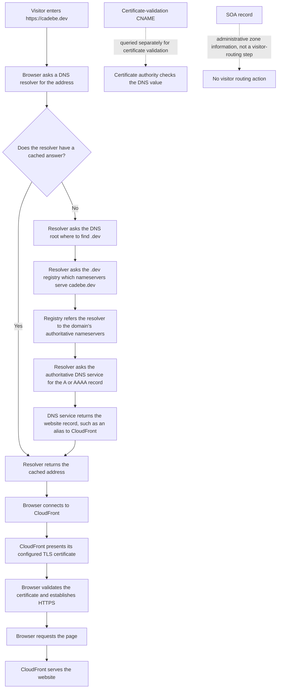

# Infrastructure Notes

This document covers TLS certificate renewal, DNS validation, ACM import, and CloudFront
configuration for `cadebe.dev`.

## Requirements for renewing the TLS certificate and importing it into AWS

- OpenSSL installed
- AWS CLI installed and authenticated
- IAM permissions for ACM and CloudFront updates
- Existing CloudFront distribution serving `cadebe.dev`

## Generate the CSR

```sh
 sudo openssl genrsa -out cadebe-csr-private.key 2048
 sudo openssl req -new -key cadebe-csr-private.key -out cadebe-csr.pem
```

Provide the CSR to the certificate provider; **do not provide the private key**.

## Submit the CSR to the certificate provider

Display and copy the CSR:

```sh
cat tls-request.csr
```

In the certificate provider's portal, request a renewal or reissue and submit the CSR. Choose
DNS-based domain validation if that option is available.

Make sure the certificate request covers all required hostnames (for example `cadebe.dev` and
`www.cadebe.dev`, if used).

## Add the DNS validation record

1. In the certificate provider's portal, find the validation details for the pending certificate.
   Copy the CNAME **name/host** and **target/value**.
2. Confirm where the domain's DNS is hosted. If it is hosted in Route 53, open the matching hosted
   zone in AWS. If DNS is hosted elsewhere, add the record there instead.
3. Create a CNAME record using the name and target supplied by the certificate provider.

- If the DNS UI appends the domain automatically, enter only the host label (for example
  `_abc123`).
- If it does not append automatically, enter the full host (`_abc123.cadebe.dev`).

4. Save the record. Use a DNS lookup tool such as `dig`, `nslookup`, or an online DNS checker to
   confirm it is visible.
5. Return to the certificate provider's portal and retry or refresh domain validation if needed.
   Once the record is detected, the certificate should be issued.

The validation CNAME is used by the certificate authority to verify control of the domain. 

## Import the certificate into AWS Certificate Manager

Once the certificate has been issued, import it into AWS Certificate Manager (ACM). For use with
CloudFront, the certificate must be in the **US East (N. Virginia), `us-east-1`** region.

Provide:

- **Certificate body:** the issued certificate, including the `BEGIN CERTIFICATE` and
  `END CERTIFICATE` lines.
- **Certificate private key:** the private key created with the CSR.
- **Certificate chain:** the chain supplied by the certificate provider, if required.

Keep the private key secure. Do not commit it to the repository or paste it into an untrusted
service.

## Configure CloudFront to use the new certificate

In the CloudFront distribution settings, select the imported ACM certificate for the domain. Confirm
the domain is included in the distribution's alternate domain names, then save the changes and wait
for the distribution update to finish.

## Verify after update

1. Confirm the CloudFront distribution status is **Deployed**.
2. Verify HTTPS response:

```sh
curl -I https://cadebe.dev
```

3. Optionally inspect the served certificate subject/issuer:

```sh
openssl s_client -connect cadebe.dev:443 -servername cadebe.dev </dev/null 2>/dev/null | openssl x509 -noout -subject -issuer -dates
```

## Website DNS and HTTPS flow

This diagram shows the DNS lookup path. The certificate-validation CNAME is queried separately; the
SOA record is administrative information rather than a visitor-routing step.


